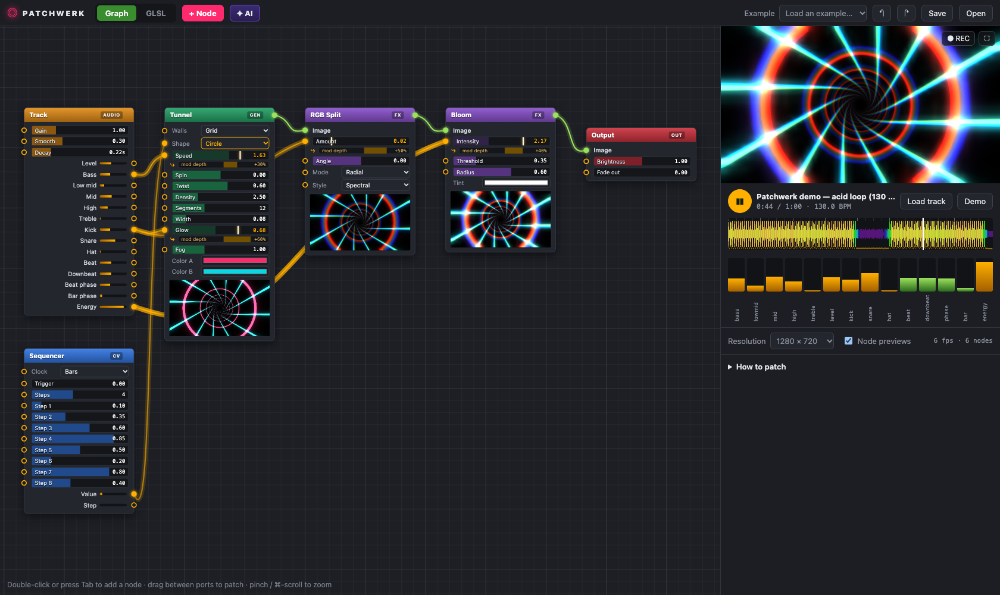

# Patchwerk

[](https://www.patreon.com/AndersBjarby)

A modular visual synth for music. Drop in a track, patch nodes together with
cables, and every shader on screen moves with the kick, the bass line and the
bar — like a wall of Eurorack, except the modules make pictures.



```bash
npm start          # → http://localhost:8270
```

No build step, no dependencies at runtime: plain ES modules + WebGL2 + Web Audio.
Chrome/Edge/Arc recommended.

## Using it

- **A track goes in.** Drop an audio file anywhere (or *Load track*). It is
  analysed once, up front: tempo, a tracked beat grid, bar phase, kick / snare /
  hat onsets, five frequency bands, slow energy, a log spectrum. Without a file
  you get a built-in acid techno loop. The last track is remembered.
- **Patch.** Double-click the grid or press <kbd>Tab</kbd> to add a node. Drag
  from a jack to a jack. Green cables carry images, orange cables carry
  control signals (0..1) into any slider — or into a dropdown, so a Sequencer can
  switch modes on the bar. A patched slider grows a *mod depth* slider: how far
  the cable pushes it from where you set it.
- **Unplug** by dragging a cable off its input, double-clicking it, or ⌥-clicking it.
- **✦ AI** (⌘K): describe what you want — "a neon tunnel that rushes on the bass and
  flashes on the kick" — and the patch assistant builds it, looks at the result,
  and fixes what's off. Ask for changes the same way. Each AI edit is one ⌘Z.
  Runs Claude Sonnet 5.5 through OpenRouter: `OPENROUTER_API_KEY` must be set
  where you run `npm start` (the key stays on the server; it listens on
  127.0.0.1 only). Override the model with `PATCHWERK_MODEL`.
- **GLSL tab:** read the shader of any node, *Fork* it into a live-editable GLSL
  node, or write your own — `uniform float p_amount; // 0 1 0.5` in the code
  becomes a patchable slider.
- **Output:** fullscreen (double-click the preview) or ● REC to record video
  with sound. Patches save to the browser automatically; *Save / Open* for files.

<kbd>Space</kbd> play · <kbd>⌫</kbd> delete · <kbd>⌘D</kbd> duplicate ·
<kbd>⌘Z</kbd>/<kbd>⇧⌘Z</kbd> undo/redo · <kbd>F</kbd> frame all · scroll pans,
pinch / ⌘-scroll zooms.

## The rack

| | |
|---|---|
| **Audio** | Track (14 outputs: level, five bands, kick, snare, hat, beat, downbeat, beat/bar phase, energy) · Band (any frequency range) · Clock (1/16 … 4-bar ramps) |
| **Control** | Number · LFO (free or beat-synced) · Wander · Sequencer · Random (S&H) · Envelope · Smooth · Math · Map Range · Gate |
| **Generators** | Solid · Noise · Gradient · Plasma · Voronoi · Stripes · Checker · Truchet · Polygon · Rings · Tunnel · Metaballs · 3D Shape · Lasers · Starfield · Sparks · Sun · Grid Floor · Scanner · Spectrum · Scope · Spectrogram · Ridges · Julia · Text |
| **Effects** | Transform · Feedback · Flow · Datamosh · Kaleidoscope · Mirror · Tile · Polar · Wave Warp · Swirl · Lens · Displace · Blur · Bloom · Zoom Blur · RGB Split · Color Adjust · Gradient Map · Posterize · Invert · Threshold · Pixelate · Halftone · Edges · Glitch · CRT · VHS · Grain · Vignette · Strobe |
| **Mix** | Blend · Crossfade · Mask · Key · Switch · Merge · Video Wall |
| **Code** | GLSL (your own shader) |

## How it works

- `src/audio/` — offline analysis (`analysis.js`, in a worker), a reader that
  answers "what is the music doing at time t" (`features.js`), the transport and
  the demo track. Everything is a function of track time, so scrubbing is exact.
- `src/graph/` — the patch model (topological order, no cycles, snapshot undo),
  the DOM/SVG editor, the add-node menu.
- `src/engine/` — one fullscreen fragment pass per image node into its own
  float framebuffer; control nodes run in JS first. Feedback nodes ping-pong.
- `src/nodes/` — the node library. **`src/nodes/CONTRACT.md` is the contract**
  for writing nodes (uniform naming, premultiplied alpha, integrated speeds).

## Tests

```bash
npm test                # analysis calibrated against tracks with known beats, graph model
npm run check:shaders   # compile + render every shader node (NaN / negative / black checks)
npm run smoke           # boot the app headless and play the demo
npm run interact        # drive the editor with a real mouse
npm run presets         # screenshot every example patch → test/out/
npm run perf            # frame cost per example on the real GPU
npm run ai-live         # the assistant against the real model (spends a few cents)
```

## Making videos

The app has a frame-exact capture mode (`?capture`), so a video's visuals react
to exactly the music under them:

```bash
node tools/bars.mjs song.mp3                       # bar start times + energy, to cut on the one
node tools/record-chat.mjs chat.json "prompt" …    # record a real assistant session for replay
node tools/capture.mjs shots.json                  # render shots → mp4 clips (format in the file header)
```

## License

MIT © 2026 Anders Bjarby
